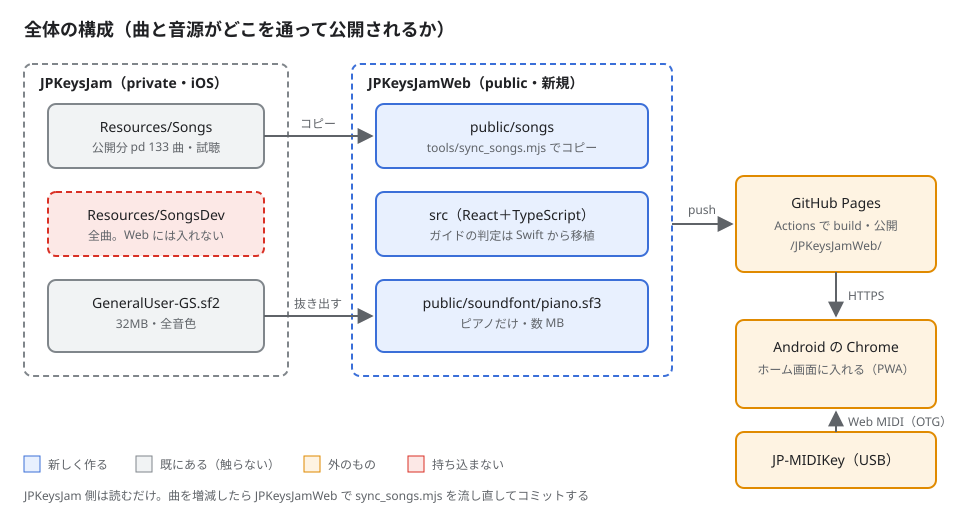
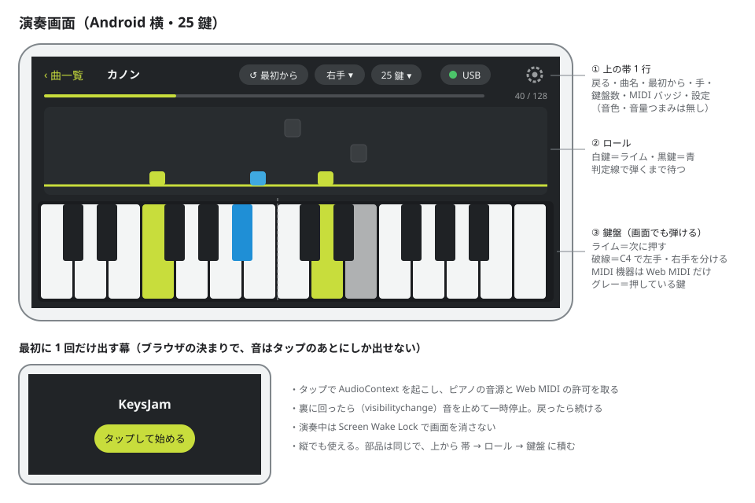

# 実装計画-JPKeysJamWeb

## 変更履歴

| 日付 | 変更者 | 変更内容 |
| --- | --- | --- |
| 2026-11-12 | Claude | フェーズ1〜4 と P5-1 を実装し、レビュー 6 回の指摘を直して typecheck・テスト 365 件・ビルドが通った。 |
| 2026-11-12 | Claude | P1-2 に手直し表の rights=pd と曲数の照合を足した（波 1 のレビューで SongsDev も全曲 free と分かったため）。 |
| 2026-11-12 | Claude | P1-7 の smfPlayer は先読みをやめ SMFPlayer.swift の移植にした（GuideSession が同じ API を使うため）。 |
| 2026-11-12 | Claude | 音源は SF3 に圧縮できず piano.sf2（2.08MB）にした。 |
| 2026-11-12 | Claude | 初版作成。Android Chrome 向け Web 版（pd 曲・弾くまで待つガイド・Web MIDI・GitHub Pages 公開）を 5 フェーズに分けた。 |

## 概要

iOS アプリ JPKeysJam の「弾くまで待つガイド」を、Android の Chrome で動く Web アプリにする。曲は著作権の切れた公開分（pd の 133 曲）だけで、GitHub Pages（public リポジトリ JPKeysJamWeb）で公開する。ガイドの判定は Swift の実装とテストを手本に TypeScript へ移植する。

- **対象**: 曲の一覧（検索・ジャンル・おすすめ・履歴）・試聴・弾くまで待つガイド（右手／左手／両手、13 鍵／25 鍵）・弾き終わり・設定・PWA・Pages への公開
- **やらないこと**: 音色の選択と調整画面・手ごとの音量つまみ・13 鍵×2 台・人気（Firebase）・Web Bluetooth（BLE）・著作権のある曲・iOS 版（JPKeysJam）の変更・JProducts の紹介ページの変更
- **技術**: Vite＋TypeScript＋React、テストは Vitest、音源は spessasynth_lib（AudioWorklet で SF2/SF3 を鳴らす。Apache-2.0）
- **関連**: iOS 版の仕様 `../JPKeysJam/docs/概要.md`（特に「決めたこと」「曲データの約束」）、配色 `../SoundEngine/Sources/JPKeyboardUI/Theme.swift`

**図**:



JPKeysJam 側は読むだけ。曲は `Resources/Songs`（公開分）だけをコピーし、`SongsDev` は持ち込まない。

## 進捗

**現在**: フェーズ5（次の一手: P5-2 GitHub に public リポジトリを作り公開する。ユーザーの確認待ち）

| フェーズ | 状態 | 完了 | 備考 |
| --- | --- | --- | --- |
| 1. 土台と曲の一覧・試聴 | ✅ 完了 | 8/8 | 目視の確認は残る |
| 2. 弾くまで待つガイドの判定 | ✅ 完了 | 5/5 | — |
| 3. 演奏画面と MIDI 鍵盤 | ✅ 完了 | 5/5 | 目視の確認は残る |
| 4. 履歴・設定・PWA | ✅ 完了 | 5/5 | 目視の確認は残る |
| 5. GitHub Pages で公開 | 🔄 進行中 | 1/3 | P5-2 は公開前にユーザーの確認が要る |

> 状態: ⬜ 未着手 / 🔄 進行中 / ✅ 完了 / ⏸️ 保留。タスクは `- [ ]` / `- [x]`。
> フェーズ内の全タスクが `- [x]` になったら ✅ にする。備考は1行まで（詳細は各フェーズ本文へ）。
> タスクの「触る」は書き換えるファイルを全部（宣言・登録・索引への追記も含む）、「依存」は先に終わっている必要があるタスク ID。

### 更新のきまり

- 更新は実装したターン内で行う（「動いた＝更新済み」と錯覚しない）
- **状態はこの表だけに書く**。フェーズ見出しには書かない
- 変更履歴は**新しい行を上に**足す。1行1文
- 計画とズレたら計画側を直し、変更履歴に残す

---

## フェーズ1: 土台と曲の一覧・試聴

**目標**: `npm run dev` で曲の一覧が出て、曲を選ぶと試聴（20 秒）がピアノで鳴る。

### タスク

- [x] **P1-1**: Vite＋React＋TypeScript＋Vitest の土台を作る。`vite.config.ts` の `base` は `/JPKeysJamWeb/`。`package.json` の scripts に `dev`・`build`・`preview`・`test`（vitest run）・`typecheck`（tsc --noEmit）・`sync:songs`・`make:soundfont` を先に全部書く。依存に `react`・`react-dom`・`spessasynth_lib`・`spessasynth_core` を入れ、版は固定する。`CLAUDE.md`（日本語。ビルド・テスト・曲の同期・やらないこと）と `.gitignore`（node_modules・dist）も作る（`_temp/` はユーザーの決まりで `_temp/.gitignore` で外す）（触る: `package.json`, `package-lock.json`, `vite.config.ts`, `tsconfig.json`, `tsconfig.node.json`, `index.html`, `src/main.tsx`, `src/App.tsx`, `src/vite-env.d.ts`, `.gitignore`, `CLAUDE.md`／依存: なし）
- [x] **P1-2**: `tools/sync_songs.mjs` を作る。`../JPKeysJam/Resources/Songs` の `songs.json`・`*.mid`・`previews/*.mid` を `public/songs/` にコピーし、`songs.json` の全曲の `access` が `free`、手直し表（`../JPKeysJam/docs/tools/catalog.csv`）で全曲が `rights=pd` かつ曲数が pd の件数と同じ、全 arrangement の `.mid` と試聴がそろっていること、`songs.json` に無い `.mid` が無いことを確かめて `OK 133 曲` と出す。`SongsDev` は読まない。最初の同期の結果（`public/songs/**`）もこのタスクで作る（触る: `tools/sync_songs.mjs`, `public/songs/**`／依存: P1-1）
- [x] **P1-3**: `tools/make_soundfont.mjs` を作る。`../JPKeysJam/Resources/SoundFonts/GeneralUser-GS.sf2` から bank 0・program 0（ピアノ）だけを残した音源を `public/soundfont/piano.sf3` に書き出す（spessasynth_core で読む。SF3 の圧縮ができなければピアノだけの SF2 を `piano.sf2` で出し、10MB 以下にする）。ライセンス文を `public/licenses/GeneralUser-GS.txt` にコピーする（触る: `tools/make_soundfont.mjs`, `public/soundfont/*`, `public/licenses/GeneralUser-GS.txt`／依存: P1-1）
- [x] **P1-4**: SMF の読み込み `src/midi/smf.ts` を作る（format 0/1、division・テンポ変更・Note On/Off・CC・Program Change を、秒の時刻つきイベント列にする）。手本は `../SoundEngine/Sources/JPMIDIKit/SMFParser.swift`。テストは `public/songs` の実際の `.mid` を読む（触る: `src/midi/smf.ts`, `src/midi/smf.test.ts`／依存: P1-1, P1-2）
- [x] **P1-5**: 配色 `src/theme.ts` と全体の CSS `src/styles.css` を作る。`Theme.swift` の Palette 5 色と Tone の式（`mix`）をそのまま移し、CSS 変数に出す。色の値はこの 2 ファイルにしか書かない（触る: `src/theme.ts`, `src/theme.test.ts`, `src/styles.css`／依存: P1-1）
- [x] **P1-6**: 音源 `src/audio/engine.ts` を作る。spessasynth_lib の WorkletSynthesizer を包み、`start()`（タップの中で AudioContext を作り、`latencyHint: 'interactive'`、音源を読む）・`noteOn/noteOff(ch, note, vel)`・`controlChange`・`allNotesOff`・`suspend/resume` を出す。ch1・ch2 は program 0 にそろえる（触る: `src/audio/engine.ts`／依存: P1-1, P1-3）
- [x] **P1-7**: SMF の再生 `src/audio/smfPlayer.ts` と試聴 `src/audio/preview.ts` を作る。smfPlayer は `SMFPlayer.swift` をそのまま移植し（hold・mutedChannels・seek・onFinished・tick。GuideSession がこの API を直接使う）、タイマーの tick ごとに今の位置までのイベントを送る。試聴は `previews/<id>.mid` を 20 秒鳴らし、別の曲を試聴したら前を止める。テストは時計を差し替えて行う（触る: `src/audio/smfPlayer.ts`, `src/audio/smfPlayer.test.ts`, `src/audio/preview.ts`／依存: P1-4, P1-6）
- [x] **P1-8**: 曲の一覧を作る。`src/library/catalog.ts`（`songs.json` の型と読み込み・ジャンル・おすすめ順。手本 `SongCatalog.swift`）、`src/library/search.ts`（手本 `SongSearch.swift` とそのテスト）、最初の幕 `src/views/StartGate.tsx`（タップで `engine.start()`）、`src/views/Home.tsx`（検索欄＋おすすめ・ジャンルの切り替え）、`src/views/SongDetail.tsx`（譜面の選択・試聴・弾く）。`App.tsx` で幕 → ホーム → 詳細をつなぐ（触る: `src/library/catalog.ts`, `src/library/catalog.test.ts`, `src/library/search.ts`, `src/library/search.test.ts`, `src/views/StartGate.tsx`, `src/views/Home.tsx`, `src/views/SongDetail.tsx`, `src/App.tsx`, 各画面の `.css`（StartGate・Home・SongDetail・App）／依存: P1-5, P1-7）

### 完了確認

```bash
cd ~/Documents/Project/JPKeysJamWeb
npm run sync:songs
# 期待: OK 133 曲
npm run make:soundfont && ls -l public/soundfont/
# 期待: piano.sf3（または piano.sf2）が 10MB 以下
npm run typecheck && npm test && npm run build
# 期待: エラーなし・全件 pass・dist/ ができる
```

- [ ] Mac の Chrome で `npm run dev` を開き、タップ → 一覧 → 曲の詳細 → 試聴が鳴る（目視）

---

## フェーズ2: 弾くまで待つガイドの判定

**目標**: 画面なしで、楽譜から作ったステップに音名を入れると進み、伴奏が次のステップの前で止まって待つことをテストで確かめられる。

判定の決まりは iOS 版と同じにする（`../JPKeysJam/docs/概要.md` の「決めたこと」）。音名だけで判定・和音は構成音の音名がそろったら進む・1 音で OK・伴奏を追い越さない窓（`GuidePacing.standard`）・和音の押しずれ 60ms・正解は楽譜の高さで鳴らす。Swift のテストを手本に、同じ入力で同じ結果になるテストを書く。

### タスク

- [x] **P2-1**: 手と鍵盤の範囲 `src/guide/hand.ts`・`src/guide/keyRange.ts` を移植する（手本 `App/Guide/Hand.swift`・`App/Logic/KeyRange.swift` とそのテスト。13 鍵 C4〜C5、25 鍵 C3〜C5、機器名で自動判定。13 鍵×2 は持たない）（触る: `src/guide/hand.ts`, `src/guide/hand.test.ts`, `src/guide/keyRange.ts`, `src/guide/keyRange.test.ts`／依存: P1-1）
- [x] **P2-2**: 楽譜のステップ `src/guide/guideScore.ts` を移植する（手本 `App/Guide/GuideScore.swift`・`Tests/GuideScoreTests.swift`。ch1＝右手・ch2＝左手、和音のまとめ幅 30ms、`hasNotes`）（触る: `src/guide/guideScore.ts`, `src/guide/guideScore.test.ts`／依存: P1-4）
- [x] **P2-3**: 判定 `src/guide/guideSession.ts` を移植する（手本 `App/Guide/GuideSession.swift`・`Tests/GuideSessionTests.swift`）。JS は 1 スレッドなのでロックは持たず、`voiced(ch, note)` が「判定して鳴らす音を返す」を 1 回で行う。手の切り替え・1 音で OK・違う鍵の回数・経過時間・一時停止・最後まで弾いたことを持つ。13 鍵×2 の機器による分け方は移さない（触る: `src/guide/guideSession.ts`, `src/guide/guideSession.test.ts`／依存: P2-1, P2-2）
- [x] **P2-4**: ロールの配置 `src/guide/rollLayout.ts` を移植する（手本 `App/Views/GuideRoll.swift` の `GuideRollLayout` と `Tests/GuideRollTests.swift`。はみ出す音は同じ音名で一番近い鍵、同じ距離なら低い方）（触る: `src/guide/rollLayout.ts`, `src/guide/rollLayout.test.ts`／依存: P2-1, P2-2）
- [x] **P2-5**: 伴奏 `src/audio/accompaniment.ts` を作る。smfPlayer の hold を GuideSession の待っているステップに合わせ、右手だけなら ch2・左手だけなら ch1 を鳴らし、両手なら ch1・ch2 を鳴らさない。伴奏のイベントは engine に直接送り、判定（GuideSession）を通さない。伴奏の Program Change と CC 0・32・7・10・11・91・93 は捨てる。あわせて iOS の AppHost に当たる演奏のつなぎ役 `GuideController`（入力の ch の振り分け・CC64 とピッチベンドの送り先と戻し・弾く人の Program Change を捨てる・All Notes Off）も持つ（触る: `src/audio/accompaniment.ts`, `src/audio/accompaniment.test.ts`／依存: P1-7, P2-3）

### 完了確認

```bash
npm run typecheck && npm test
# 期待: guide/ と accompaniment のテストが全件 pass
```

---

## フェーズ3: 演奏画面と MIDI 鍵盤

**目標**: 曲の詳細の「弾く」から演奏画面へ進み、画面の鍵盤か USB の MIDI 鍵盤で 1 曲を最後まで弾ける。

**画面**:



上の帯は 1 行で、音色と音量つまみは無い。最初の幕のタップで音と MIDI の許可を取る。

### タスク

- [x] **P3-1**: Web MIDI の入力 `src/midi/webMidi.ts` を作る。`navigator.requestMIDIAccess()`、機器の一覧と抜き差し（`onstatechange`）、Note On/Off（ベロシティ 0 の Note On は Off）・CC64・ピッチベンドを読み、購読者に渡す。対応していないブラウザでは「画面の鍵盤だけ」で動く（触る: `src/midi/webMidi.ts`, `src/midi/webMidi.test.ts`／依存: P1-1）
- [x] **P3-2**: 鍵盤 `src/views/Keyboard.tsx` を作る。13／25 鍵、複数の指で押せる（Pointer Events）、押している鍵＝グレー、次に押す鍵＝白鍵ライム・黒鍵青（rollLayout と同じ鍵）、25 鍵で C4 の破線（触る: `src/views/Keyboard.tsx`, `src/views/Keyboard.css`／依存: P1-5, P2-4）
- [x] **P3-3**: ロール `src/views/GuideRoll.tsx` を作る。canvas に、鍵盤の列にそろえて棒を下ろし、判定線で待つ。次のステップは濃く、その先は遠いほど薄く（触る: `src/views/GuideRoll.tsx`／依存: P1-5, P2-4）
- [x] **P3-4**: 演奏画面 `src/views/PlayView.tsx` と弾き終わり `src/views/FinishCard.tsx` を作る。上の帯（戻る・曲名・最初から・手・鍵盤数・MIDI バッジ・設定のボタン。設定はフェーズ4 まで無効）、進み具合、ロール、鍵盤をつなぐ。入力（Web MIDI・画面の鍵盤）→ `guideSession.voiced` → engine。裏に回ったら（`visibilitychange`）伴奏を止めて一時停止し、戻ったら続ける。演奏中は Screen Wake Lock を取る。縦横は幅と高さの比で切り替える（触る: `src/views/PlayView.tsx`, `src/views/PlayView.css`, `src/views/FinishCard.tsx`／依存: P2-3, P2-5, P3-1, P3-2, P3-3）
- [x] **P3-5**: `App.tsx` で曲の詳細の「弾く」から演奏画面へ進み、戻る・弾き終わりの「曲に戻る」で詳細を開いたホームへ戻す（触る: `src/App.tsx`, `src/views/SongDetail.tsx`／依存: P1-8, P3-4）

### 完了確認

```bash
npm run typecheck && npm test && npm run build
# 期待: エラーなし・全件 pass
```

- [ ] Mac の Chrome で画面の鍵盤を使い、1 曲を右手・左手・両手で最後まで弾ける（目視）
- [ ] 画面イメージと同じ配置になる（目視）

---

## フェーズ4: 履歴・設定・PWA

**目標**: 履歴と設定が端末に残り、Android でホーム画面に入れて通信なしでも開ける。

### タスク

- [x] **P4-1**: 履歴 `src/library/history.ts` と設定 `src/library/settings.ts` を作る。どちらも localStorage（読めないときは既定値で動く）。履歴は最大 200 件（手本 `PlayHistory.swift`）。設定は鍵盤数（自動／13／25）・弾く手・1 音で OK・曲ごとの譜面（触る: `src/library/history.ts`, `src/library/history.test.ts`, `src/library/settings.ts`, `src/library/settings.test.ts`／依存: P1-1）
- [x] **P4-2**: ホームに履歴を足す（最近弾いた曲の棚と、今日・昨日・それより前で区切る履歴の一覧。1 件消す・すべて消す）（触る: `src/views/Home.tsx`, `src/views/HistoryList.tsx`／依存: P1-8, P4-1）
- [x] **P4-3**: 設定のシート `src/views/SettingsSheet.tsx` を作る（鍵盤数・1 音で OK・つながっている MIDI 機器・ライセンス（GeneralUser GS・spessasynth・曲の出どころ））（触る: `src/views/SettingsSheet.tsx`, `src/views/SettingsSheet.css`／依存: P3-1, P4-1）
- [x] **P4-4**: PWA にする。`vite-plugin-pwa` で manifest（名前 JPKeysJam、横向き優先、テーマ色は theme.ts の bg）と service worker（アプリ・`songs/`・`soundfont/` を先読みでキャッシュ）を作る。アイコンは `../JPKeysJam/App/Assets.xcassets/AppIcon.appiconset/AppIcon.png` から 192・512 を書き出す（触る: `vite.config.ts`, `package.json`, `package-lock.json`, `public/icons/*`, `index.html`／依存: P1-1）
- [x] **P4-5**: つなぎ込み。演奏の開始で履歴に記録、設定（鍵盤数・手・1 音で OK・譜面）を PlayView と SongDetail で読み書き、上の帯の設定ボタンでシートを開く（触る: `src/App.tsx`, `src/views/PlayView.tsx`, `src/views/SongDetail.tsx`／依存: P3-5, P4-2, P4-3）

### 完了確認

```bash
npm run typecheck && npm test && npm run build && ls dist/sw.js dist/manifest.webmanifest
# 期待: エラーなし・全件 pass・2 ファイルがある
```

- [ ] `npm run preview` を Mac の Chrome で開き、DevTools の Application で service worker が動き、オフラインでも開ける（目視）

---

## フェーズ5: GitHub Pages で公開

**目標**: `https://junpeiwada.github.io/JPKeysJamWeb/` で誰でも開け、Android の Chrome で MIDI 鍵盤を使って弾ける。

### タスク

- [x] **P5-1**: `.github/workflows/pages.yml` を作る（main への push で `npm ci`・`npm test`・`npm run build` を流し、`actions/deploy-pages` で `dist/` を公開する）。`README.md`（何か・対応ブラウザ（Android／PC の Chrome・Edge。Firefox は不可）・USB OTG でつなぐこと・ライセンス）を書く（触る: `.github/workflows/pages.yml`, `README.md`／依存: P4-4）
- [ ] **P5-2**: GitHub に public リポジトリ `Junpeiwada/JPKeysJamWeb` を作り、main を push し、Pages の公開元を GitHub Actions にする。**外への公開なので、実行の直前にユーザーへ確認する**（触る: なし（GitHub 側の設定）／依存: P5-1）
- [ ] **P5-3**: 公開後の確認で分かったことを `README.md`・`CLAUDE.md` に反映し、JPKeysJam の `MEMORY.md` の「参照」に Web 版の URL を 1 項目足す（触る: `README.md`, `CLAUDE.md`, `../JPKeysJam/MEMORY.md`／依存: P5-2）

### 完了確認

```bash
curl -sI https://junpeiwada.github.io/JPKeysJamWeb/ | head -1
# 期待: HTTP/2 200
curl -s https://junpeiwada.github.io/JPKeysJamWeb/songs/songs.json | python3 -c "import json,sys;print(len(json.load(sys.stdin)))"
# 期待: 133
```

- [ ] Android の Chrome で開き、USB でつないだ JP-MIDIKey25 で 1 曲を最後まで弾ける（目視）
- [ ] 押してから鳴るまでの遅れが気にならない程度か（目視。気になるなら値と端末をメモする）

---

## 全体の完了基準

- [ ] Android の Chrome で、公開 URL から pd の曲を選び、USB の MIDI 鍵盤で弾くまで待つガイドどおりに弾ける
- [ ] `npm run typecheck && npm test && npm run build` がエラーなし
- [ ] 公開物に `SongsDev` の曲が 1 曲も無い（`sync_songs.mjs` の検査が通る）

## 注意点

- **音はタップのあとにしか出ない**: AudioContext と音源の読み込みは最初の幕のタップの中で始める
- **Web MIDI は HTTPS か localhost だけ**: 公開前に Android の実機で試すなら、USB でつないで `adb reverse tcp:5173 tcp:5173` とし、端末の Chrome で `http://localhost:5173/JPKeysJamWeb/` を開く
- **音の遅れ**: Android は端末によって数十〜100ms 超の遅れがある。弾くまで待つ作りなので伴奏はずれないが、押してから鳴るまでの遅れは残る。`latencyHint: 'interactive'` 以上の手は打たない
- **伴奏を判定に通さない**: iOS 版で、伴奏を判定に通したときにデッドロックした（`概要.md`）。Web でも、伴奏は engine へ直接送る
- **曲の権利**: 公開リポジトリと Pages に置くのは `Resources/Songs`（pd）だけ。`sync_songs.mjs` 以外の方法で曲を足さない
- **版の固定**: npm の依存は公開から 2 週間以上たった版を選び、`package.json` で固定する

## ディレクトリ構成

```
JPKeysJamWeb/
├── .github/workflows/pages.yml
├── CLAUDE.md / README.md / package.json / vite.config.ts / index.html
├── docs/実装計画-JPKeysJamWeb.md, docs/images/
├── tools/sync_songs.mjs, tools/make_soundfont.mjs
├── public/
│   ├── songs/（songs.json・*.mid・previews/）
│   ├── soundfont/piano.sf2（SF3 の圧縮はエンコーダーが無く断念。2.08MB）
│   ├── licenses/GeneralUser-GS.txt
│   └── icons/
└── src/
    ├── main.tsx, App.tsx, theme.ts, styles.css
    ├── midi/（smf.ts, webMidi.ts）
    ├── audio/（engine.ts, smfPlayer.ts, preview.ts, accompaniment.ts）
    ├── guide/（hand.ts, keyRange.ts, guideScore.ts, guideSession.ts, rollLayout.ts）
    ├── library/（catalog.ts, search.ts, history.ts, settings.ts）
    └── views/（StartGate, Home, SongDetail, HistoryList, PlayView, Keyboard, GuideRoll, FinishCard, SettingsSheet）
```

## 並列実行の割り振り

共有の約束（波 1 で決める）: MIDI のイベント型は `src/midi/types.ts`（レーン E が作る）。ch は 0 始まり（0 = ch1 = 右手）。手は `src/guide/hand.ts` の `PlayHands = 'leftOnly' | 'both' | 'rightOnly'`、鍵盤数の設定は `src/guide/keyRange.ts` の `KeyRangePreference = 'auto' | 'keys13' | 'keys25'`（どちらもレーン C が作る）。

| 波 | レーン | タスク | 書き込み先 |
| --- | --- | --- | --- |
| 1 | A | P1-1 | package.json, package-lock.json, vite.config.ts, tsconfig*.json, index.html, src/main.tsx, src/App.tsx, src/vite-env.d.ts, .gitignore, CLAUDE.md |
| 1 | B | P1-2 | tools/sync_songs.mjs, public/songs/** |
| 1 | C | P1-5, P2-1 | src/theme.ts, src/theme.test.ts, src/styles.css, src/guide/hand*.ts, src/guide/keyRange*.ts |
| 1 | D | P3-1, P4-1 | src/midi/webMidi*.ts, src/library/history*.ts, src/library/settings*.ts |
| 1 | E | P1-4（先行: MIDI の型） | src/midi/types.ts, src/midi/smf*.ts |
| 2 | A | P1-3 | tools/make_soundfont.mjs, public/soundfont/*, public/licenses/* |
| 2 | B | P1-6 | src/audio/engine.ts |
| 2 | C | P2-2 | src/guide/guideScore*.ts |
| 2 | D | P4-4 | vite.config.ts, package.json, package-lock.json, public/icons/*, index.html |
| 3 | A | P1-7 | src/audio/smfPlayer*.ts, src/audio/preview.ts |
| 3 | B | P2-3 | src/guide/guideSession*.ts |
| 3 | C | P2-4 | src/guide/rollLayout*.ts |
| 3 | D | P4-3 | src/views/SettingsSheet.* |
| 4 | A | P1-8 | src/library/catalog*.ts, src/library/search*.ts, src/views/StartGate.tsx, src/views/Home.tsx, src/views/SongDetail.tsx, src/App.tsx |
| 4 | B | P2-5（演奏のつなぎ役も持つ） | src/audio/accompaniment*.ts |
| 4 | C | P3-2, P3-3 | src/views/Keyboard.*, src/views/GuideRoll.tsx |
| 5 | A | P3-4 | src/views/PlayView.*, src/views/FinishCard.tsx |
| 5 | B | P4-2 | src/views/Home.tsx, src/views/HistoryList.tsx |
| 5 | C | P5-1 | .github/workflows/pages.yml, README.md |
| 6 | A | P3-5, P4-5 | src/App.tsx, src/views/SongDetail.tsx, src/views/PlayView.tsx |
| 7 | メイン | P5-2（ユーザーに確認してから）, P5-3 | GitHub 側, README.md, CLAUDE.md, ../JPKeysJam/MEMORY.md |
